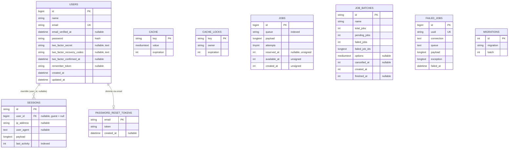

# ERD — Database `f3nbytes` (MySQL/MariaDB)

> 9 tabel bawaan Laravel + Fortify. Model aplikasi: `App\Models\User` satu-satunya.
> Lihat juga: [Overview](../overview/OUTLINE-FEATURES.md) · [PRD](../overview/PRD.md) · [Arsitektur](../overview/ARCHITECTURE.md) · [Flowchart](./flowchart.md)
>
> Diagram di bawah memakai Mermaid — tampil otomatis di GitHub/GitLab.

## Catatan Relasi

- `sessions.user_id → users.id`: nullable — tamu (guest) tercatat dengan `user_id = null`.
- `password_reset_tokens.email → users.email`: relasi logis via email (tanpa FK database).
- `cache`, `cache_locks`, `jobs`, `job_batches`, `failed_jobs`: tabel framework
  (driver `database` untuk CACHE_STORE & QUEUE_CONNECTION) — tidak berelasi ke `users`.
- `migrations`: versi migrasi yang sudah jalan (4 batch: users, cache, jobs, 2FA).
- Tidak ada tabel `projects`: data showcase proyek masih hardcode di
  `resources/js/pages/welcome.tsx` dan `resources/js/pages/projects.tsx`
  (lihat roadmap di [PRD](../overview/PRD.md)).
