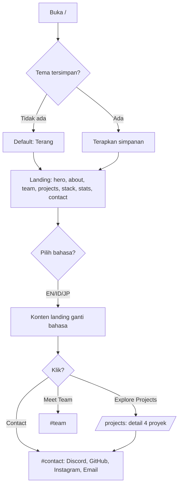
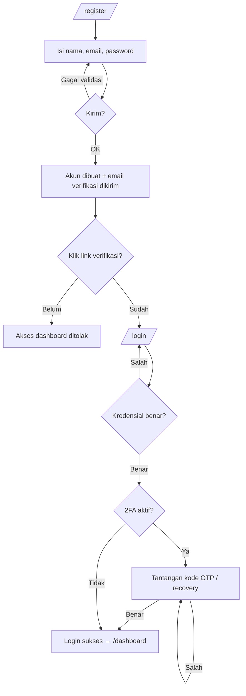
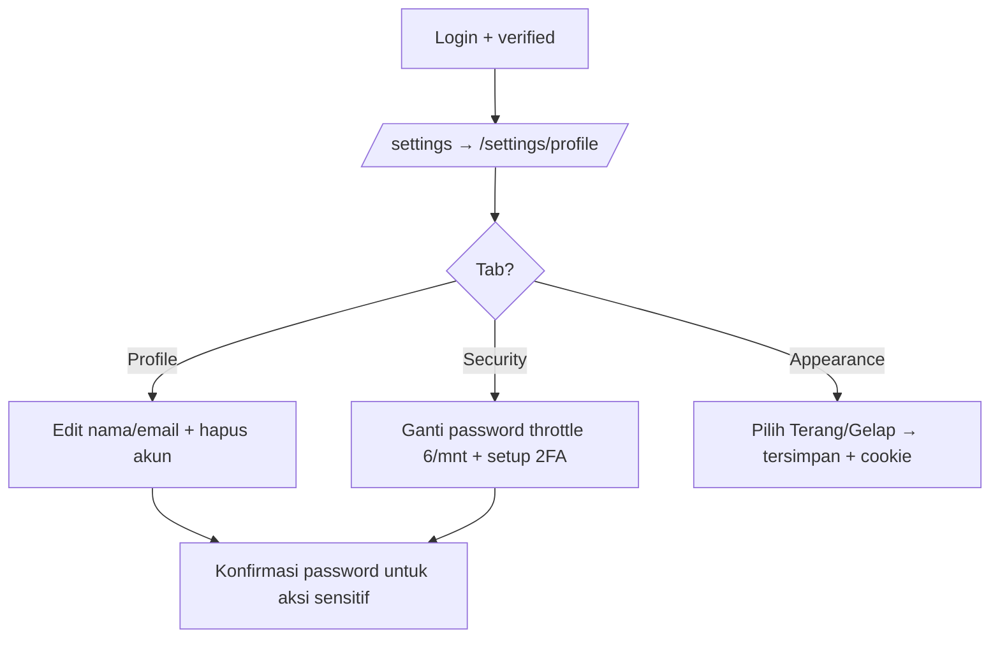
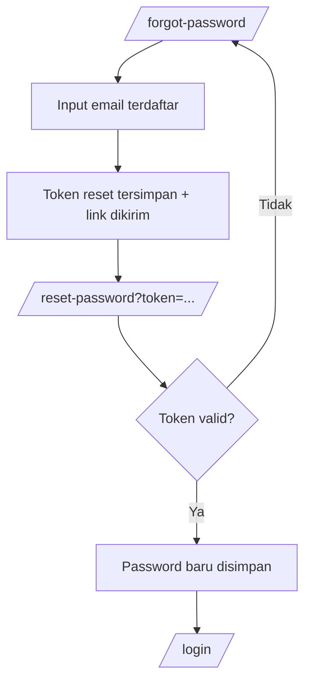

# Flowchart — F3N-Bytes Studio Website

> Kumpulan alur utama (Mermaid — tampil otomatis di GitHub/GitLab).
> Lihat juga: [Overview](../overview/OUTLINE-FEATURES.md) · [PRD](../overview/PRD.md)

## 1. Pengunjung → Landing → Kontak

## 2. Register → Verifikasi → Login (+ 2FA)

## 3. Settings Member

## 4. Lupa Password

